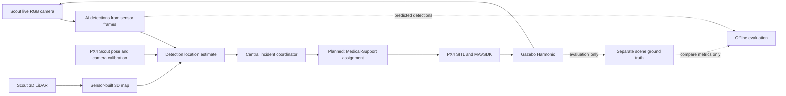

# Drone-Swarm: Multi-Drone Disaster Response Simulation

A simulation prototype for exploring how a small drone team could search an
earthquake and landslide scene, report incidents, and coordinate specialist
responses. It uses **PX4 SITL**, **Gazebo Harmonic**, and **MAVSDK-Python** on
Ubuntu. It does not use ROS or ROS 2.

The project has three simulated roles:

- **Scout:** flies with a downward-facing RGB camera and searches the scene.
- **Medical-Support:** intended to respond to reported human victims.
- **Fire-Response:** intended to respond to reported fires.

**Current development scope (2026-11-01):** Scout and Medical-Support
(Ambulance) are active. Fire-Response (Fireman) is temporarily excluded while
its PX4 IMU/preflight fault remains unresolved. Prior Fireman results below are
historical only and do not count toward current acceptance. Keep its files and
configuration intact. Continue Tasks 10.3–14 incrementally with PX4 SITL,
Gazebo Harmonic, MAVSDK-Python, and the planned infrastructure-independent
MANET; do not add ROS or ROS 2.

The target workflow is: Scout camera frames and 3D LiDAR → detections and map
updates → estimated scene locations → incident assignment → specialist drone
mission → operator monitoring. Camera streaming and basic Scout flight have
been demonstrated. Person and fire/smoke inference and a first camera/pose/map
location-estimation pass have been exercised on recorded frames. The location
results and detector metrics are preliminary; camera-axis calibration and
independent multi-run evaluation remain open. Scout has an early pose-registered
LiDAR cloud, but mapping validation and obstacle avoidance are not complete.
Terminal event monitoring and per-run JSON report generation are implemented
in the coordinator; they have not yet been exercised during a fresh live
simulation. Incident-registry runtime validation and dispatch remain open.
Role descriptions are goals, not claims of completed autonomous capability.

## Project status

| Area | Status |
| --- | --- |
| Apron earthquake/landslide Gazebo world | Selected environment; used by the default launcher |
| Three PX4 SITL vehicles | Have spawned and connected in prior runs |
| Scout vertical takeoff, hover, and landing | 3 m check completed; user confirmed normal landing |
| Scout camera | Gazebo image topic and H.264/RTP stream observed; airborne RGB frame captured |
| Victim scene annotations | Five model poses are recorded as evaluation-only ground truth; never detection or incident input |
| Scout live perception | Camera-only person and fire/smoke inference has run on recorded/live camera frames. Models and outputs are experimental; detections are not yet validated for reliable operational use. |
| Scout 3D LiDAR and mapping | Sensor is publishing; one pose-registered cloud and terrain overlay were captured. The PLY and metadata were transferred to the local map receiver. Mapping accuracy, obstacle representation, and coverage remain unvalidated. |
| Camera-based world localization | Preliminary map-surface candidates were generated from detections, PX4 pose, nominal camera geometry, and Scout LiDAR. Two fire examples had 0.31 m and 0.33 m horizontal error against references used only after estimation. Calibration and independent evaluation are incomplete. |
| Incident registry | Recorded replay created four provisional spatial clusters from 19 map candidates; replaying the same 14 reports left registry counts unchanged. Three candidates were operator-attested after camera/LiDAR overlay review; one weak smoke candidate was rejected. These attestations are not independent metric localization accuracy. Unlocalized detections remain observations. |
| Incident coordinator and messaging | Local UDP AI-report and map receivers have been exercised. Acknowledged replay passed for 14 initial and 14 duplicate reports; a deterministic first-ACK drop was recovered by retry with 14/14 acknowledged. Actual lossy-network behavior remains unvalidated. This does not validate a MANET or enable specialist dispatch. |
| Day 9 coordinator and assignment prototype | Acceptance verified: read-only status collection on all three landed/armable vehicles; one validated fire dry-run proposal; queue reservation and copied-ledger completion/release; localhost accepted/duplicate acknowledgements and first-ACK-loss retry; and live camera detections acknowledged by the coordinator. No response-drone flight command was sent. Actual lossy-network/MANET behavior remains unvalidated; live mission dispatch is Day 11. |
| LiDAR guard and local replanning prototype | Historical: Ambulance completed a CLEAR bounded move and landing; Fireman completed a STOP/hold/land run. The bounded runner now recognizes Scout's `/scout/lidar/points` topic, but Scout guarded movement has not been validated or integrated into its survey mission. A planar corridor selector is unit-tested, but in-flight bypass remains unvalidated. Scan freshness under flight load, approach/descent/landing avoidance, 3D routing, and deconfliction remain open. |
| Battery-aware missions and current-based battery model | Planned; no validated battery model yet |
| Live terminal monitor | Coordinator event stream plus automatic per-run JSON reports; browser dashboard removed |
| Two-drone waypoint integration | Pending: diagnose the earlier MAVSDK gRPC/Offboard interruption and validate Scout control before integrated Scout/Ambulance missions |

The full day-by-day progress and acceptance criteria are in the
[14-day implementation plan](docs/DRONE_SWARM_14_DAY_PLAN.md). The updated
Days 10.3–14 roadmap scopes active work to Scout and Ambulance: local obstacle
avoidance, coordinator and MANET integration, battery-aware missions, terminal monitoring,
system tests, and a repeatable two-drone demonstration. It distinguishes
historical Fireman work from current acceptance and separates demonstrated
results from pending work.

## System design



Gazebo provides the simulated environment and vehicles. PX4 handles flight
control; MAVSDK provides mission-level commands. The existing discrete MAPPO
research code is preserved separately. It is a possible future high-level
coordination component and does not replace PX4 flight control. See the
[legacy RELAY/MAPPO guide](docs/RELAY_LEGACY_README.md) for its original setup.

## Requirements

- Ubuntu with PX4 Autopilot SITL and Gazebo Harmonic installed.
- Python 3 and the `mavsdk-grpc` package in the project’s `.venv-mavsdk`
  environment.
- Host `/usr/bin/python3` with PyGObject/GStreamer bindings for the provided
  one-frame camera capture helper.
- The Scout camera stream uses UDP port 5600; close other receivers on that port
  before capturing a frame.

The PX4 checkout is external to this repository. The launcher defaults to
`/tmp/PX4-Autopilot`; set `PX4_AUTOPILOT_DIR` if your PX4 checkout is elsewhere.

Create the MAVSDK virtual environment once if it is not already present:

```bash
python3 -m venv .venv-mavsdk
source .venv-mavsdk/bin/activate
python -m pip install --upgrade pip
python -m pip install 'mavsdk-grpc>=3.17,<4'
```

The camera capture helper uses the host Python GStreamer bindings, so it runs
with `/usr/bin/python3`, not with `.venv-mavsdk`.

## Start the simulation

From the repository root, launch the three-vehicle SITL session:

```bash
./integration/mavsdk_controller/launch_three_px4.sh
```

The launcher defaults to `worlds/earthquake_landslide_apron_world.sdf` and
writes logs under `/tmp/drone-swarm-px4-multi-<uid>/`. Do not start a second
launcher while another PX4/Gazebo session is running. The launcher’s `stop`
subcommand stops PX4 and Gazebo processes system-wide; check that they belong to
this project before using it.

### Verified Scout-only hover check

Use a second terminal after all vehicles have connected. This test moves Scout
vertically only and does not use Offboard waypoints:

```bash
source .venv-mavsdk/bin/activate
python integration/mavsdk_controller/scout_hover_check.py \
  --altitude 3 --hover-seconds 10 \
  --telemetry-log /tmp/scout-hover-check.jsonl
```

A higher vertical hover can be requested with `--altitude 8 --hover-seconds 30`.
Capture during the hold and wait for the script to confirm landing before
starting another flight.

### Capture a Scout camera frame

While Scout is airborne and its camera stream is active, close any other viewer
receiving UDP 5600, then run:

```bash
/usr/bin/python3 integration/mavsdk_controller/capture_scout_frame.py \
  --output /tmp/scout_camera_frame.ppm
xdg-open /tmp/scout_camera_frame.ppm
```

A successful capture prints the saved image dimensions. This helper captures a
single frame; it does not detect or identify victims.

## Current limitations and safe continuation

- Do not retry `three_drone_takeoff_demo.py` yet. Its MAVSDK gRPC stream closed
  during Offboard waypoint control, and PX4 reported a Hold failsafe after the
  link loss. The cause has not been established. Diagnose it and validate a
  short Scout-only waypoint before a multi-drone waypoint mission.
- CPU YOLO person and fire/smoke model inference runs on Scout camera frames.
  Metrics from the current small datasets are preliminary, and detections must
  not be presented as reliable operational performance.
- Operational incidents must be generated only from live Scout sensor
  observations and AI outputs. The separate world ground-truth file is reserved
  for post-run evaluation and must never supply detections or incident
  coordinates.
- `scout_live_person_detection.py` writes versioned, timestamped RGB
  observations with image-space boxes. It can also run a supplied fire/smoke
  model. Optional coordinator reports still carry detections as observations;
  detections without supported location estimates remain unlocalized. The
  current camera calibration is nominal and the location candidates are not
  dispatchable.
- The fire/smoke assets have produced Gazebo missing particle texture warnings;
  check and repair their resources before relying on those visuals.
- Do not change PX4 parameters, drone models, propellers, or low-level flight
  control to work around an unexplained issue.
- Do not claim autonomous detection, medical diagnosis, real-world readiness,
  or response capability without successful evidence.

### Run live Scout camera inference

With the disarmed Scout simulation active, the detector can use the direct
Gazebo Image topic so every inference retains the source message's simulation
timestamp and sequence. The legacy RTP mode remains available, but RTP PTS is
not mapped to a Gazebo image timestamp.

```bash
cd "/home/ganesh/Drone Swarm/Drone-Swarm"
.venv-perception/bin/python \
  integration/mavsdk_controller/scout_live_person_detection.py \
  --input-source gazebo-image \
  --gazebo-world earthquake_landslide_world \
  --model ./yolo26n.pt \
  --interval 1 --max-inferences 5 --imgsz 640 --conf 0.10 \
  --output-dir "/tmp/scout_live_$(date -u +%Y%m%dT%H%M%SZ)"
```

The output path must be new or empty; the script refuses to overwrite an
existing capture. YOLO latency, inference rate, image sequence gaps, and
bounded-writer queue delay are recorded. Image files and JSONL records are
written by a bounded background worker; a full queue applies backpressure.
A direct Python Gazebo subscriber still receives the full 1280x960 image
payload (3,686,400 bytes per frame), so benchmark simulation RTF before
operational use. Detections are image-space only and remain unlocalized and
non-dispatchable until trusted calibration, synchronized LiDAR, and a valid
Scout pose are supplied. No coordinator movement command is sent by this tool.

## Repository map

| Path | Purpose |
| --- | --- |
| `worlds/earthquake_landslide_apron_world.sdf` | Selected disaster-response world |
| `worlds/earthquake_landslide_apron_ground_truth.json` | Five victim model IDs and poses for offline evaluation only; never operational detections |
| `worlds/disaster_assets/` | Local world meshes, victim models, and fire/smoke assets |
| `integration/mavsdk_controller/launch_three_px4.sh` | Starts the three PX4 SITL vehicles and Gazebo |
| `integration/mavsdk_controller/scout_hover_check.py` | Scout vertical takeoff, hover, and land check |
| `integration/mavsdk_controller/capture_scout_frame.py` | One-frame camera stream capture helper |
| `integration/mavsdk_controller/drones.json` | Vehicle roles, ports, and demo waypoint offsets |
| `src/relay/viewer.py` | Existing MAPPO replay viewer; it is separate from the live terminal monitor |
| `docs/DRONE_SWARM_14_DAY_PLAN.md` | Day-by-day status, acceptance criteria, and remaining work |
| `docs/RELAY_LEGACY_README.md` | Preserved setup guide for the discrete MAPPO/RELAY research code |

**Configuration note:** the launcher uses spawn poses defined in its shell
script. The `spawn_pose` fields in `drones.json` do not set Gazebo spawn poses.

## Project boundaries

This is a simulation prototype. It does not include real flights,
hardware-in-the-loop testing, ROS, or direct motor control from MAPPO. More
varied model training/evaluation and sensor-based 3D mapping remain project
work; their performance remains unverified. Keep existing MAPPO checkpoints
and experiments intact.
